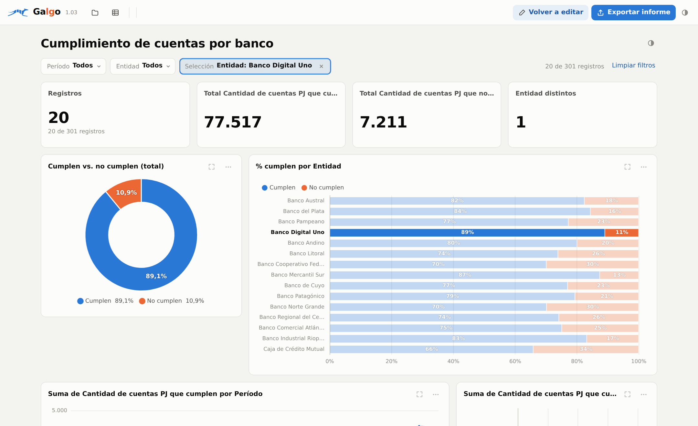
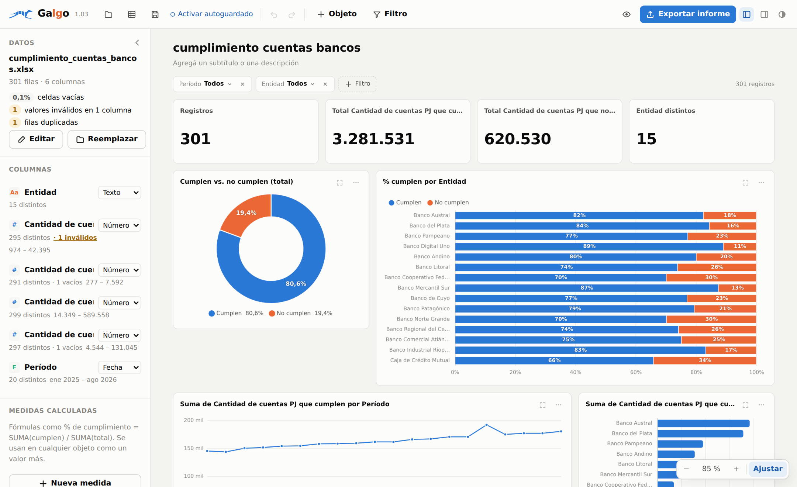
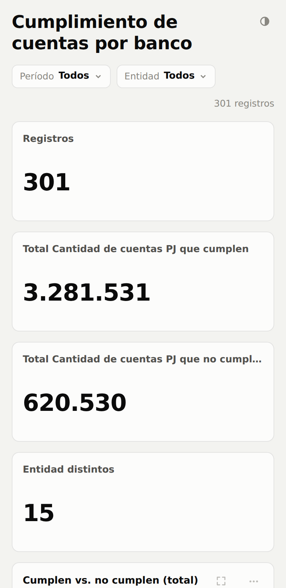

# Galgo

**Tableros interactivos en un solo archivo HTML.** Se carga un Excel o CSV, se arma el tablero con gráficos y filtros, y se exporta un HTML que cualquiera abre con doble clic: sin instalar nada, sin licencias y sin internet.

**[▶ Probar Galgo en el navegador](https://lucasfg87.github.io/Galgo/)** · **[⬇ Descargar galgo.html](https://github.com/lucasfg87/Galgo/releases/latest)** · **[🎬 Ver el video (1 min)](docs/galgo-demo.mp4)**

## Para qué sirve

Muchos informes terminan en una planilla de Excel o en un PowerPoint con gráficos estáticos: no se pueden filtrar y cada pregunta nueva obliga a rehacerlos. Con Galgo, quien recibe el informe puede explorarlo:

- filtrar por período, entidad o cualquier columna;
- hacer clic en una barra, en una porción o en una etiqueta para filtrar todo el tablero;
- ampliar un gráfico, ver el detalle de registros o copiarlo como imagen.

## Cómo se usa

1. **Abrir `galgo.html`** con Chrome o Edge, con doble clic o desde el link de arriba.
2. **Cargar los datos:** arrastrar un Excel (.xlsx, .xls) o un CSV, o cargarlos a mano. Galgo arma un tablero sugerido al instante. Para probar, está el archivo [`ejemplos/cumplimiento_cuentas_bancos.xlsx`](ejemplos/cumplimiento_cuentas_bancos.xlsx), con datos sintéticos.
3. **Armar el tablero:** agregar indicadores, barras, líneas, donas, tablas y textos; moverlos y cambiarles el tamaño en el lienzo, con guías de alineación; elegir colores; sumar filtros y medidas calculadas (por ejemplo, % de cumplimiento).
4. **Exportar el informe:** «Exportar informe» genera un único HTML con los datos adentro, listo para enviar.

Con «Guardar proyecto» se guarda el trabajo para seguir editándolo más adelante, con autoguardado opcional.

## Funcionalidades

- **Tablero sugerido** a partir de las columnas detectadas: texto, número y fecha. Reconoce períodos como `202601`.
- **Filtrado cruzado** con un clic, como en las herramientas de BI.
- **Perfil de calidad de los datos:** celdas vacías, valores inválidos y filas duplicadas.
- **Medidas calculadas** con fórmulas del tipo `SUMA(cumplen) / SUMA(total)`.
- **Páginas de texto** para notas metodológicas o aclaraciones, con imágenes y botones de acceso desde los objetos.
- **Lienzo libre** con zoom, guías de alineación, deshacer y rehacer.
- **Modo oscuro**, y el informe se adapta al celular.

## Privacidad

Todo se procesa en la computadora de quien usa Galgo. No hay servidor ni nube: los datos no se envían a ningún lado, tampoco cuando se usa desde el link de GitHub Pages.

Importante: **el HTML exportado lleva los datos adentro.** Quien lo recibe puede ver todas las filas de las columnas incluidas, aunque no aparezcan en los gráficos. Al exportar, Galgo permite elegir qué columnas van.

## Límites

- Pensado para volúmenes de una hoja de Excel. Con más datos, la velocidad depende de la computadora. No es una herramienta de big data.
- Probado en Chrome y Edge, que son los recomendados. El guardado en una carpeta elegida y el autoguardado requieren esos navegadores; en otros, los archivos se descargan.
- En el celular, el informe tiene que abrirse en el navegador. Algunas vistas previas de WhatsApp o del correo no ejecutan el archivo y lo muestran en blanco: en ese caso, usar «Abrir con» → Chrome o Safari.

## Versiones

- **1.03:** paneles que se ocultan, lienzo con zoom igual al informe final, guías de alineación al mover objetos, y los informes ya no se dañan si el archivo cambia de codificación al enviarse.
- **1.02:** medidas calculadas, colores por objeto, lienzo libre, deshacer y rehacer, autoguardado, modo foco y copiar gráficos como imagen.
- **1.01:** páginas de texto con imágenes y botones de acceso desde los objetos.
- **1.0:** primera versión.

## Sobre el proyecto

Galgo es un proyecto personal de [Lucas Gómez](https://www.linkedin.com/in/lucas-gomez-data), analista de datos especializado en calidad y gobernanza de datos. Lo desarrollé con asistencia de IA (Claude, de Anthropic): yo definí la necesidad, el diseño funcional y las pruebas; la IA aceleró la programación.

El nombre esconde mis iniciales: Ga**lg**o.

Sugerencias y errores: se pueden dejar en [Issues](https://github.com/lucasfg87/Galgo/issues).

## Licencia

Uso gratuito; no se permite modificarlo ni venderlo. Ver [LICENCIA.md](LICENCIA.md). Incluye Chart.js (MIT) y SheetJS (Apache 2.0): ver [AVISOS-DE-TERCEROS.md](AVISOS-DE-TERCEROS.md).
